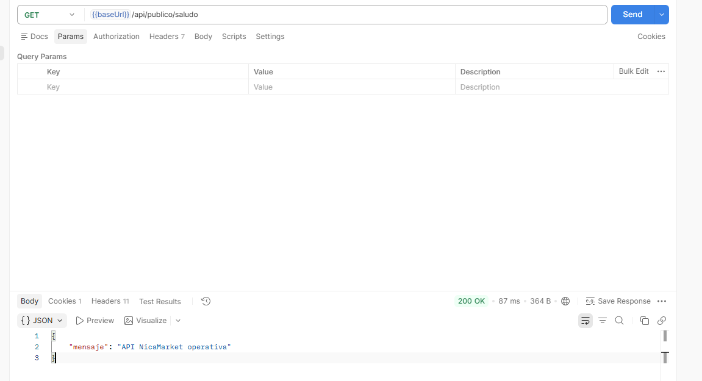
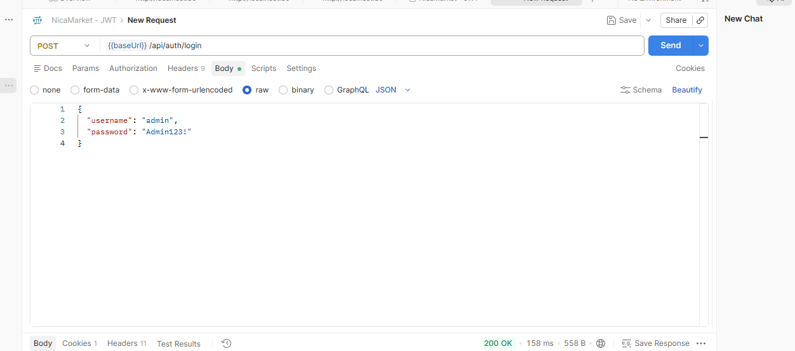
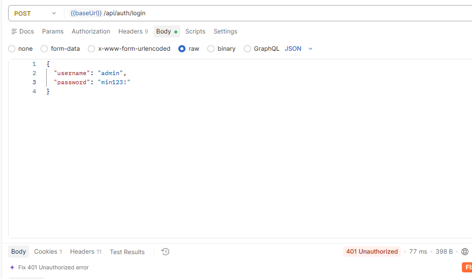
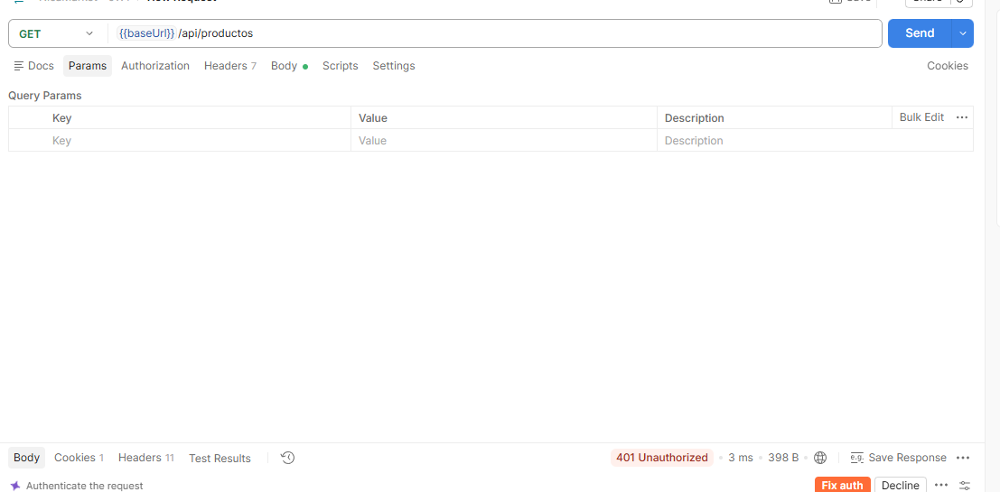
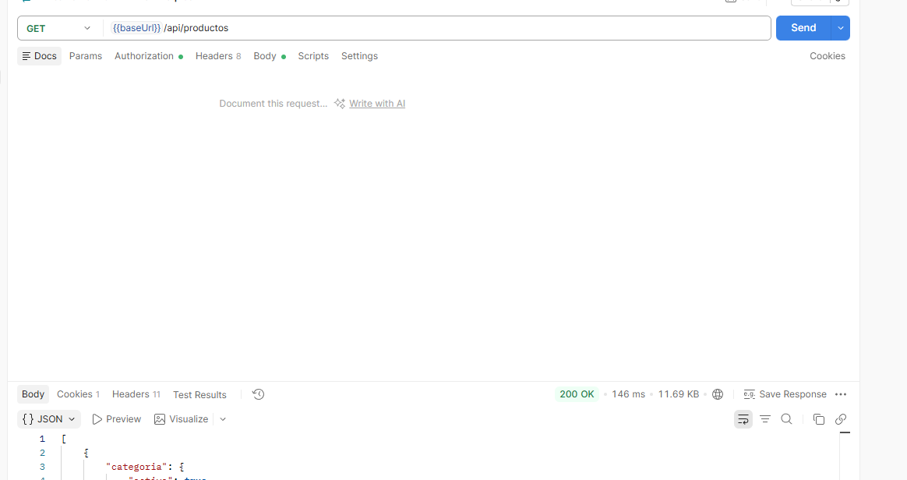

1. Diferencia entre HTTP 401 y 403
401 Unauthorized: el servidor no sabe quién eres. Falta el token, está mal formado, expiró o la firma es inválida. Es un problema de autenticación.
403 Forbidden: el servidor sí sabe quién eres (el token es válido), pero tu rol no tiene permiso para ese recurso. Es un problema de autorización.

2. Por qué no basta con leer el contenido de un JWT

Porque el contenido solo está codificado en Base64, no cifrado, y cualquiera puede leerlo y modificarlo. Un atacante podría cambiar "roles":["USER"] por "roles":["ADMIN"] y reenviar el token. Lo que hace confiable al token es la firma: solo quien tiene la clave secreta puede producir una firma válida. Si el contenido se altera, la firma deja de coincidir y el servidor lo rechaza. Por eso hay que verificar la firma (y la expiración) antes de creer en cualquier claim.

3. Función de JwtDecoder

JwtDecoder recibe el token en texto, lo valida y lo convierte en un objeto Jwt con sus claims. En tu configuración (NimbusJwtDecoder con la clave HS256) hace lo siguiente:

Verifica que la firma coincida usando la clave secreta y el algoritmo HS256.
Comprueba que el token no haya expirado.
Si algo falla, lanza una excepción y Spring Security responde 401.
Si todo está bien, entrega los claims (sub, roles, etc.), que el JwtAuthenticationConverter transforma en las autoridades del usuario.

Su contraparte es JwtEncoder, que crea y firma los tokens en el login.

4. Riesgos de publicar la clave de firma

Con HS256 la misma clave firma y valida, así que quien la tenga puede:

Falsificar tokens de cualquier usuario, incluido admin, con cualquier rol y fecha de expiración, y el servidor los aceptaría como legítimos.
Suplantar identidades y acceder o modificar datos sin conocer ninguna contraseña.
Saltarse por completo la seguridad, porque no deja rastros distintos a los de un usuario real.
No poder corregirlo fácilmente: los tokens ya emitidos siguen siendo válidos hasta que expiren, y la única solución es rotar la clave, lo que invalida todos los tokens existentes y obliga a todos a iniciar sesión de nuevo.

## Evidencias de la verificación en Postman

### 1. Endpoint público (sin autenticación)
`GET /api/publico/saludo` responde 200.

### 2. Login correcto
`POST /api/auth/login` devuelve el token JWT.

### 3. Login con contraseña incorrecta
Se rechaza con 401.

### 4. Endpoint protegido sin token
`GET /api/productos` sin token responde 401.

### 5. Endpoint protegido con token
`GET /api/productos` con Bearer Token responde 200.

