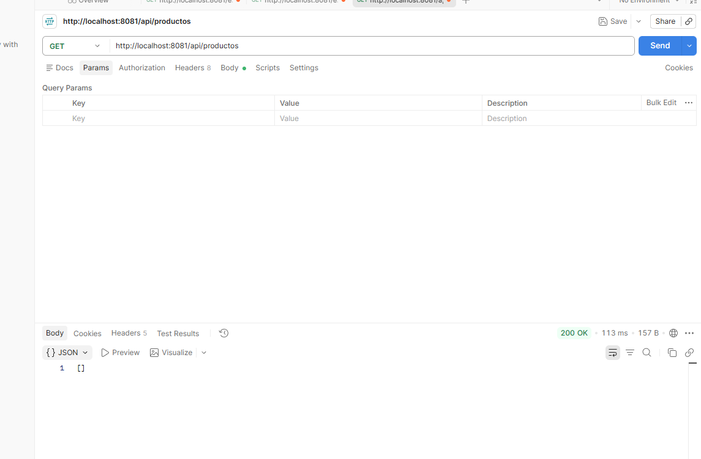
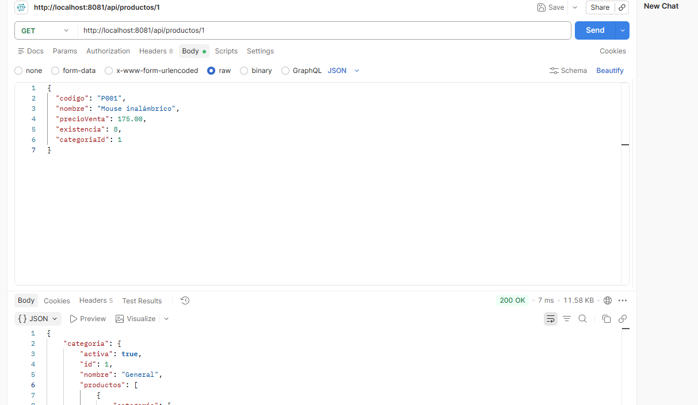
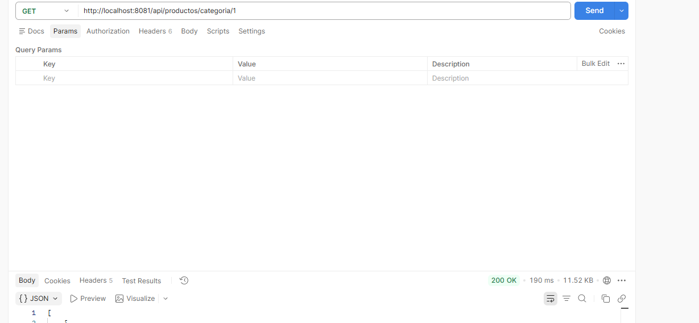
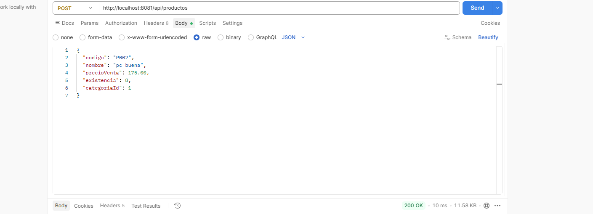
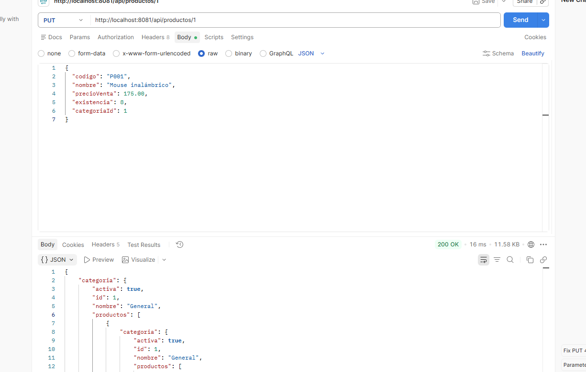
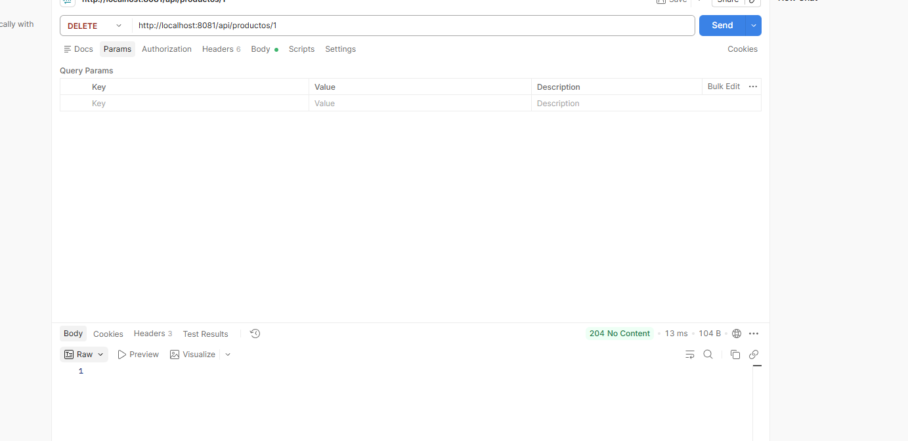

1. ¿Cuál es la función de Spring Data JPA?
Es un módulo de Spring que simplifica la implementación de la capa de acceso a datos (DAO). Abstrae JPA proporcionando repositorios genéricos con operaciones CRUD integradas, paginación, ordenamiento y generación automática de consultas a partir del nombre de los métodos, reduciendo significativamente el código repetitivo.

2. ¿Qué función cumple Hibernate?
Es un marco de trabajo de Mapeo Objeto-Relacional (ORM). Funciona como el motor que se encarga de traducir los objetos y clases de Java a tablas y registros en la base de datos relacional (y viceversa). Ejecuta las consultas SQL, gestiona las transacciones, maneja la memoria caché y administra la carga perezosa (lazy loading).

3. ¿Qué diferencia existe entre JPA y Hibernate?
JPA (Jakarta Persistence API): Es la especificación o estándar de Java. Define únicamente interfaces, anotaciones (como @Entity, @Id) y reglas de comportamiento, pero no contiene código que ejecute la lógica.

Hibernate: Es la implementación concreta de la especificación JPA. Es la librería ejecutable que Spring utiliza por defecto para realizar las operaciones físicas sobre la base de datos.

4. ¿Qué función cumple @Entity?
Es una anotación de JPA que marca una clase Java como una Entidad de Persistencia. Le indica a Hibernate que la clase representa una tabla en la base de datos y que sus instancias equivalen a filas de dicha tabla.

5. ¿Qué función cumple @ManyToOne?
Establece una relación de muchos a uno entre entidades (por ejemplo, muchos Productos pertenecen a una Categoría). Le indica al motor ORM que en la tabla de la entidad actual debe crearse una columna de clave foránea (Foreign Key) hacia la entidad principal.

6. ¿Qué función cumple @JoinColumn?
Se utiliza para especificar el nombre de la columna que actuará como clave foránea en la tabla física de la base de datos (por ejemplo, @JoinColumn(name = "categoria_id")).

7. ¿Qué función cumple JpaRepository?
Es una interfaz de Spring Data JPA que ofrece métodos predefinidos para interactuar con la base de datos. Al extender de JpaRepository, obtienes automáticamente métodos para guardar (save), buscar (findById, findAll), eliminar (deleteById) y paginar, sin necesidad de escribir código SQL manual.

8. ¿Por qué se utilizan migraciones de base de datos?
Las herramientas de migración (como Flyway o Liquibase) permiten llevar un control de versiones del esquema de la base de datos. Aseguran que todos los miembros del equipo y los distintos entornos (desarrollo, pruebas, producción) mantengan exactamente la misma estructura de tablas mediante scripts automatizados y trazables.

9. ¿Qué diferencia existe entre V1, V2 y V3 en las migraciones?
Representan el orden de versión secuencial y cronológico en el que se ejecutan los archivos de migración:

V1__...sql: Define la estructura inicial del proyecto (creación de las primeras tablas).

V2__...sql: Agrega cambios o nuevas tablas de forma incremental sobre la versión 1 (por ejemplo, añadir la tabla proveedor).

V3__...sql: Aplica modificaciones o correcciones posteriores sobre el esquema existente (por ejemplo, agregar nuevas columnas o relaciones).

10. ¿Qué problema puede producir una relación bidireccional al generar JSON?
Produce un error de recursión infinita (o referencia circular / StackOverflowError).

Ocurre cuando la librería de serialización (como Jackson) intenta convertir la Entidad A que contiene a la Entidad B a JSON; al procesar la Entidad B, esta a su vez intenta convertir la Entidad A que la contiene, generando un bucle infinito que agota la memoria del sistema.

Soluciones principales:

Uso de DTOs (Data Transfer Objects): Convertir las entidades a DTOs antes de retornarlas en el controlador (es la mejor práctica).

Anotaciones de Jackson: Utilizar @JsonIgnore en una de las propiedades, o combinar @JsonManagedReference / @JsonBackReference.

## Pruebas en Postman

### GET /api/productos (listar)

### GET /api/productos/{id} (buscar)

### GET /api/productos/categoria/{id}

### POST /api/productos (crear)

### PUT /api/productos/{id} (actualizar)

### DELETE /api/productos/{id} (eliminar)
